# PLP-JavaCC-Compiller

A complete compiler for **X++**, a small object-oriented language, built with the JavaCC parser generator. It covers every phase: lexical analysis, parsing with error recovery, syntax tree construction, a three-phase semantic analysis, and code generation for the JVM. X++ programs end up as `.class` files and run on any Java virtual machine.

**Course:** Programming Languages Design (Projeto de Linguagens de Programação) · **Year:** 2017 · **Language:** Java 8+, JavaCC 5.0 · **Based on:** Márcio Delamaro, *Como Construir um Compilador Utilizando Ferramentas Java* (Novatec, 2004)

## About

The compiler follows the project developed chapter by chapter in Delamaro's book, which defines the X++ language and the overall design. It was built in 2017 in Eclipse with the JavaCC plugin. The grammar file was typed in and annotated by hand, and parts of the code generator and the syntax tree printer were edited. The X++ test programs in [`testes/`](testes/), including a Bubble Sort, were written from scratch to exercise the compiler. The compiler was presented in class as an end-to-end demonstration of every phase, compiling and running those programs.

X++ has classes (nested and with inheritance), constructors, `int` and `string` types, multidimensional arrays, `if`/`else`, `for`, `break`, `return`, `read` and `print`. Integer constants can be written in decimal, octal (`17o`), hexadecimal (`1Fh`) and binary (`101b`).

```c
class soma {
	int start() {          // entry point of the program
		int a;
		a = 2 + 3;
		print "a = " + a + "\n";
		return 0;
	}
}
```

## How it works

```mermaid
flowchart LR
    SRC["program.x"] --> LEX["Lexical analysis<br/>langXTokenManager"]
    LEX --> SYN["Parsing + error recovery<br/>langX (LL, JavaCC)"]
    SYN --> AST["Syntax tree<br/>syntacticTree/"]
    AST --> SEM["Semantic analysis<br/>3 phases"]
    SEM --> GEN["Code generation<br/>CodeGen"]
    GEN --> JAS["program.x.Class.jas<br/>(Jasmin assembly)"]
    JAS --> JASMIN["Jasmin<br/>assembler"]
    JASMIN --> CLS["Class.class"]
    CLS --> JVM["JVM<br/>+ langXrt.Runtime"]
```



| Phase | Where | What it does |
|---|---|---|
| Lexical | `langX++.jj` → `langXTokenManager` | Tokens, comments, invalid characters and unterminated strings. Errors are counted and analysis continues. |
| Syntactic | `langX++.jj` → `langX` | Recursive descent parser generated by JavaCC. On a syntax error it skips tokens until one in the synchronization set (`recovery/First`, `RecoverySet`), so it reports several errors per run instead of stopping at the first. |
| Syntax tree | `syntacticTree/` | One node class per construct (`ClassDeclNode`, `ForNode`, `AddNode`...). `-print_tree` prints it. |
| Semantic, phase 1 | `semanalysis/ClassCheck` | Registers every class, including nested ones, and rejects duplicate class names. |
| Semantic, phase 2 | `semanalysis/VarCheck` | Fields, methods and constructors: unknown types and superclasses, duplicate method and constructor signatures. |
| Semantic, phase 3 | `semanalysis/TypeCheck` | Bodies: types of expressions, assignments and calls, `return`, `break`, undeclared names. |
| Code generation | `codegen/CodeGen` | Walks the tree and emits Jasmin assembly, one `.jas` per class, computing the stack size each method needs. |
| Symbol table | `symtable/` | Nested scopes for classes, methods and variables, shared by the semantic phases and code generation. |
| Runtime | `langXrt/Runtime` | `read` support (reads integers and strings from standard input). |

The semantic phases build on each other, and `CodeGen extends TypeCheck`, so code generation runs during the last pass over the tree.

For the program above, `a = 2 + 3` and the `print` statement become:

```
		ldc 2
		ldc 3
		iadd
		istore 1
		getstatic java/lang/System/out Ljava/io/PrintStream;
		ldc "a = "
		iload 1
		invokestatic java/lang/Integer/toString(I)Ljava/lang/String;
		invokevirtual java/lang/String/concat(Ljava/lang/String;)Ljava/lang/String;
		...
		invokevirtual java/io/PrintStream/print(Ljava/lang/String;)V
```

And `-print_tree` shows the tree the parser built:

```
13: AtribNode ===> 14 15
14: VarNode ===> a
15: AddNode ===> 16 + 17
16: IntConstNode ===> 2
17: IntConstNode ===> 3
```

## Structure

```
src/
├── parser/        langX++.jj (grammar: lexer, parser, recovery, tree) + files generated by JavaCC
├── recovery/      synchronization sets for syntax error recovery
├── syntacticTree/ syntax tree nodes and the tree printer
├── symtable/      symbol table
├── semanalysis/   semantic analysis, phases 1–3
├── codegen/       Jasmin code generation
└── langXrt/       runtime used by the generated programs
testes/            X++ programs written for the course (Bubble Sort, nested classes, one per error type)
exemplos/          X++ examples from the book, chapter by chapter (several are fragments, on purpose)
test/              regression tests (2026)
build.sh           builds the compiler without touching the original sources
```

## Running

Requires a JDK (8 or newer) and, to turn the `.jas` files into `.class` files, [Jasmin 2.4](https://jasmin.sourceforge.net/) (`jasmin.jar`). The JavaCC-generated parser is already in `src/parser`, so JavaCC is only needed to change the grammar.

```bash
./build.sh                                   # compiles the compiler into build/classes

cd testes
java -cp ../build/classes parser.langX bubblesort.x       # → bubblesort.x.bubblesort.jas
java -jar /path/to/jasmin.jar bubblesort.x.bubblesort.jas  # → bubblesort.class
java -cp .:../build/classes bubblesort                    # runs it (use ; instead of : on Windows)
```

Compiler options: `-print_tree` prints the syntax tree, `-debug_recovery` shows which tokens are skipped during error recovery, and `-debug_AS` traces the parser.

## Tests

```bash
JASMIN=/path/to/jasmin.jar test/run.sh
```

```
Compilação:
  ok    SClass.x
  ok    atribstat.x
  ...
  ok    arrays.x
Execução (Jasmin: jasmin.jar):
  ok    bubblesort (execução)
  ok    matriz (execução)
  ok    arrays (execução)
  ok    bintree (execução)

34 testes, 0 falhas
```

The script compiles all 30 X++ programs (book examples, the 2017 tests and new regression programs) and compares the compiler messages with [`test/expected/`](test/expected/). This covers the success cases and every kind of error: lexical, syntactic and the three semantic phases. With `JASMIN` set, it also assembles the complete programs, runs them on the JVM with fixed input and checks their output. Without it, only the compilation step runs.

## Example

[`testes/bubblesort.x`](testes/bubblesort.x), written in X++ for the course:

```c
int [][] sort() {
	int i, j;
	for(i = 0; i < tam; i = i + 1) {
		for(j = 0; j < tam - i - 1; j = j + 1) {
			if(lista[j][0] > lista[j + 1][0]) {
				int aux;
				aux = lista[j][0];
				lista[j][0] = lista[j + 1][0];
				lista[j + 1][0] = aux;
			}
		}
	}
	return lista;
}
```

Compiled, assembled and run on the JVM with input `5`, `42 7 19 3 25`:

```
Language X runtime system. Version 0.1
Tamanho do array: Digite os elementos do vetor.
...
42 7 19 3 25
3 7 19 25 42
```

Errors are reported with their position, phase by phase ([`testes/erro_semantico.x`](testes/erro_semantico.x)):

```
0 Erros léxicos encontrados.
0 Erros sintáticos encontrados
Line 6 column 17: Class B not found.
Line 7 column 17: Variable b not found
2 Semantic Errors found (phase 3)
```

## Provenance

Everything from 2017 was uploaded in a single commit (Oct 23, 2017), at the end of the course. The files themselves show they come from a working environment and not from a copy:

- **Eclipse project.** `.project` and `.settings/sf.eclipse.javacc.prefs` point to the JavaCC plugin in the author's home directory (`/home/patterson/.p2/pool/plugins/sf.eclipse.javacc_1.5.33/jars/javacc-5.0.jar`).
- **Two file encodings.** The support files from the book are in ISO-8859-1. The files edited on Linux are in UTF-8: the grammar, `CodeGen`, `Symtable`, `PrintTree` and the test programs. In the edited files, the book's original comments carry the `�` left by opening a Latin-1 file in a UTF-8 editor, and the lines added later have correct accents. The originals are kept as they are, and `build.sh` converts copies to compile them.
- **Generated output.** `testes/` includes the `.jas` files generated in 2017, and the current build produces `bubblesort.x.bubblesort.jas` byte for byte identical. The committed `.class` files were compiled for Java 8 (class file version 52).
- **Version string.** The compiler prints `X++ Compiler - Version 1.0 - 2017`.

## Notes

What changed in 2026:

- **`build.sh`.** Compiles the mixed-encoding sources without modifying them.
- **Bug fix: one-dimensional arrays.** The code generator emitted `newarray I` instead of `newarray int`, and `anewarray Ljava/lang/String;` (a type descriptor) instead of `anewarray java/lang/String` (an internal class name). With Jasmin 2.4 and a current JVM, `new int[n]` fails to assemble, and `new string[n]` or `new SomeClass[n]` produce classes the JVM rejects at load time. Multidimensional arrays (`multianewarray`) were not affected, which probably explains why `bubblesort.x` stores its vector as `int[size][1]`. This also made the book's `bintree-with-main.x` run. [`test/programs/arrays.x`](test/programs/arrays.x) covers it.
- **Regression tests** for compilation and execution (`test/run.sh`).

The repository name keeps the original spelling ("Compiller").
