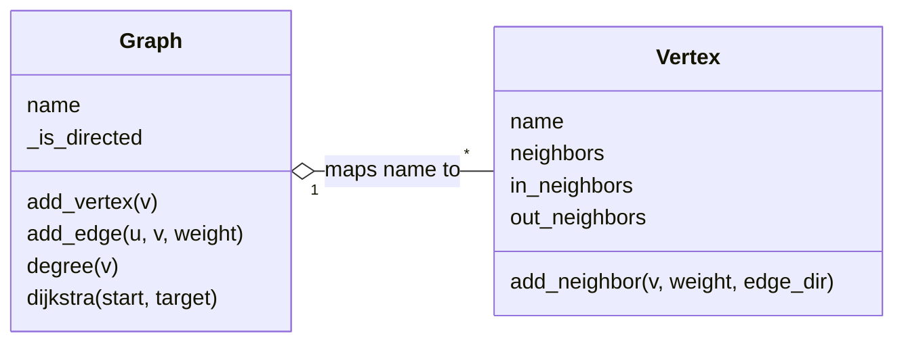

# graph_theory_python

A graph library in pure Python implementing core graph-theory concepts: degree analysis, connectivity, BFS/DFS, all-paths search, Dijkstra's shortest path and the Erdős–Gallai theorem.

**Course:** Graph Theory · **Year:** 2017 · **Language:** Python 3 (standard library only)

## About

Built while studying graph theory, to turn each definition from class (degree, leaf, source, sink, density, diameter, degree sequence…) into working code. Supports directed and undirected graphs, weighted edges, parallel edges and loops.

## How it works

The main implementation (`graph_adjl.py`) stores the graph as an **adjacency list**: `Graph` is a `dict` mapping each vertex name to a `Vertex`, and each `Vertex` keeps `neighbors` (undirected) or `in_neighbors` / `out_neighbors` (directed) as `dict[vertex] -> list[weight]`. A list of weights per neighbor is what allows **parallel edges**.



| Feature | Members |
|---|---|
| Building | `add_vertex`, `add_edge`, `rm_vertex`, `rm_edge` |
| Degrees | `degree`, `min_degree`, `max_degree`, `degree_sequence` |
| Classification | `isolated_vertices`, `leaves`, `sources`, `sinks`, `pendants` |
| Metrics | `density`, `diameter`, `is_connected` (weak connectivity for directed graphs) |
| Search | `i_bfs` / `r_bfs`, `i_dfs` / `r_dfs` (iterative and recursive versions), `bfs_paths` / `dfs_paths` (all paths, as generators) |
| Shortest path | `dijkstra` (uses the lowest weight among parallel edges) |
| Theorems | `is_degree_sequence`, `erdoes_gallai` |

**Erdős–Gallai:** a non-increasing sequence d₁ ≥ … ≥ dₙ is the degree sequence of a simple graph iff its sum is even and, for every k,
Σᵢ₌₁ᵏ dᵢ ≤ k(k−1) + Σᵢ₌ₖ₊₁ⁿ min(dᵢ, k).

`graph_adjm.py` is a smaller **adjacency-matrix** version (vertices, weighted edges and printing), written to compare the two representations: lists are compact for sparse graphs; matrices give O(1) edge lookup at O(V²) space.

## Structure

```
src/main/
├── main.py              ← demo: builds a directed weighted graph and prints every metric
└── graph/
    ├── graph_adjl.py    ← adjacency-list Graph + Vertex (main implementation)
    └── graph_adjm.py    ← adjacency-matrix Graph (comparison prototype)
tests/
├── test_graph_adjl.py   ← 42 tests: building, degrees, classification, connectivity, metrics, search, Dijkstra, theorems
└── test_graph_adjm.py   ← 3 tests for the matrix version
```

## Running

**Requirements:** Python 3.6+

From the project root (`graph_theory_python/`), so the `src` package resolves:

```bash
python -m src.main.main
```

## Tests

```bash
python -m unittest discover -s tests -t .
```

```
.............................................
----------------------------------------------------------------------
Ran 45 tests in 0.003s

OK
```

## Example

The demo builds this directed graph (with parallel edges A→B and A→G, loops on A and I):

```
A → B: [5, 2] → A: [7] → G: [10, 2]
B → C: [5] → K: [3]
C → D: [5] → J: [3]
D → E: [5]
E → A: [5]
F → None
G → A: [4] → F: [4]
H → G: [5]
I → I: [4]
J → D: [2] → C: [2]
K → None
```

and prints:

```
Min degree: 1
Max degree: 8
Degree sequence: (8, 5, 4, 4, 3, 3, 2, 2, 1, 1, 1)
Isolated: []
Connected: False
Is degree sequence: True
Diameter: 6
Density: 0.118
Erdős–Gallai: True
Shortest path: ['A', 'B', 'C', 'D', 'E']
Weight: 17.0
Leaves: ['F', 'H', 'K']
Sources: ['H']
Sinks: ['F', 'K']
Pendants: [('F', 'G'), ('H', 'G'), ('K', 'B')]
```

`Connected: False` because **I** only has a loop. The shortest path takes the weight-2 edge A→B instead of the weight-5 one.

## Notes

- `graph_adjm.py` covers only the basics; all algorithms live in the adjacency-list version.
- `erdoes_gallai` applies to simple undirected graphs; on a directed graph or multigraph it only checks the sequence.
- A pending-features list (complete, bipartite, Eulerian/Hamiltonian paths, isomorphism…) sits at the end of `graph_adjl.py`, in Portuguese.
- Revised in 2026: unit tests added, plus fixes found by them in `is_connected` (state leaking between calls through a mutable default argument), `dijkstra` (sinks reported as unreachable), `density` (doubled for directed graphs) and `diameter` (counted vertices instead of edges), and in the matrix version's printing.
