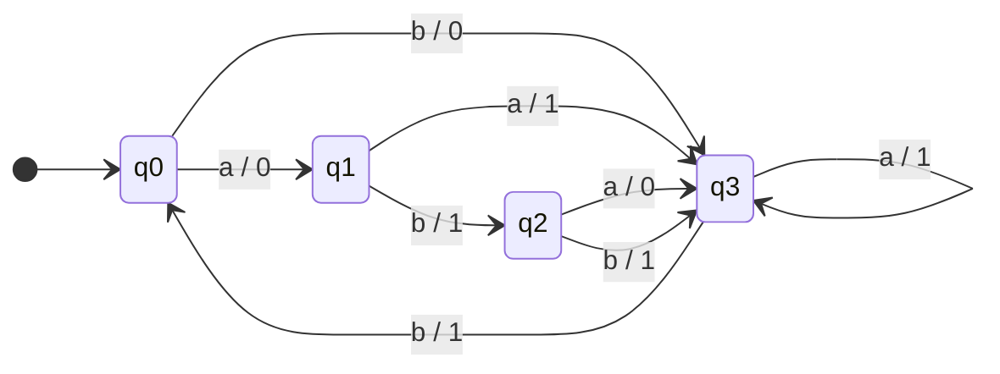

# mealy-and-moore-machines

Interactive simulator of a Mealy machine and a Moore machine over the alphabet {a, b}, printing every transition and the output it produces.

**Course:** Formal Languages and Automata · **Year:** 2017 · **Language:** C (C99)

## About

Mealy and Moore machines are finite-state transducers: instead of only accepting or rejecting a word, they emit an output symbol as they read it. They differ in *where* the output comes from:

- **Mealy:** output depends on the current state **and** the input symbol (output on the transition).
- **Moore:** output depends **only** on the current state (output on the state).

This project implements one machine of each kind, both with four states (q0–q3) and the binary output alphabet {0, 1}.

## How it works

Each machine is a hand-coded transition function: a `switch` on the current state nested with a `switch` on the input symbol. Any symbol outside {a, b} rejects the word.

### Mealy machine — transition / output

| State | a | b |
|---|---|---|
| → q0 | q1 / 0 | q3 / 0 |
| q1 | q3 / 1 | q2 / 1 |
| q2 | q3 / 0 | q3 / 1 |
| q3 | q3 / 1 | q0 / 1 |



### Moore machine — transition / state output

Same transitions as above; the output is attached to each state:

| State | Output | a | b |
|---|---|---|---|
| → q0 | 0 | q1 | q3 |
| q1 | 1 | q3 | q2 |
| q2 | 0 | q3 | q3 |
| q3 | 1 | q3 | q0 |

A Moore machine emits one symbol for the initial state before reading anything, so a word of length *n* produces *n + 1* output symbols, while a Mealy machine produces *n*.

## Structure

```
mealy_and_moore.c   ← menu, mealy(), moore() and terminal helpers
```

## Running

**Requirements:** GCC (or any C99 compiler)

```bash
# Linux
gcc -o mealy_and_moore mealy_and_moore.c

# Windows (MinGW): OS_WINDOWS switches to cls / fflush(stdin)
gcc -DOS_WINDOWS -o mealy_and_moore.exe mealy_and_moore.c

./mealy_and_moore
```

Pick a machine (`0` = Mealy, `1` = Moore), type a word over {a, b}, and the program prints the path.

## Example

Word `abbab` on the **Mealy** machine → output `01111`:

```
q0 -- a : 0 --> q1
q1 -- b : 1 --> q2
q2 -- b : 1 --> q3
q3 -- a : 1 --> q3
q3 -- b : 1 --> q0
```

Same word on the **Moore** machine → output `010110` (first column is the state output):

```
0	q0 -- a --> q1
1	q1 -- b --> q2
0	q2 -- b --> q3
1	q3 -- a --> q3
1	q3 -- b --> q0
0
```

A symbol outside the alphabet (e.g. `abca`) stops the run with `Palavra rejeitada.`

## Notes

- The program's messages are in Portuguese.
- The transition functions are hard-coded; a table-driven version (`next[state][symbol]`, `out[state][symbol]`) would make the machines configurable.
- Clearing the input buffer uses `__fpurge` (glibc) on Linux and `fflush(stdin)` on Windows; neither is portable C.
