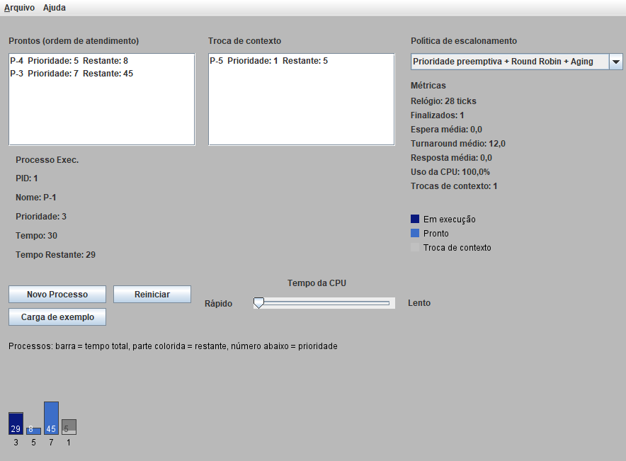
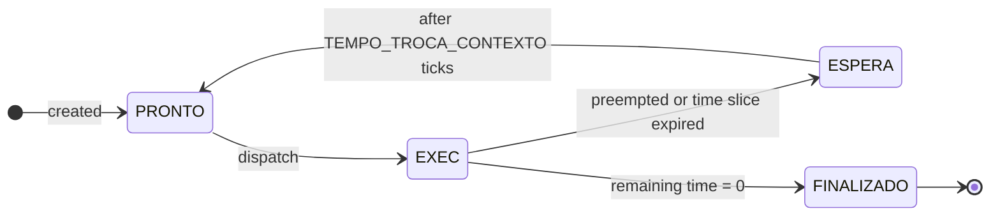
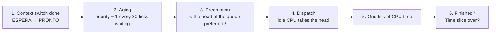
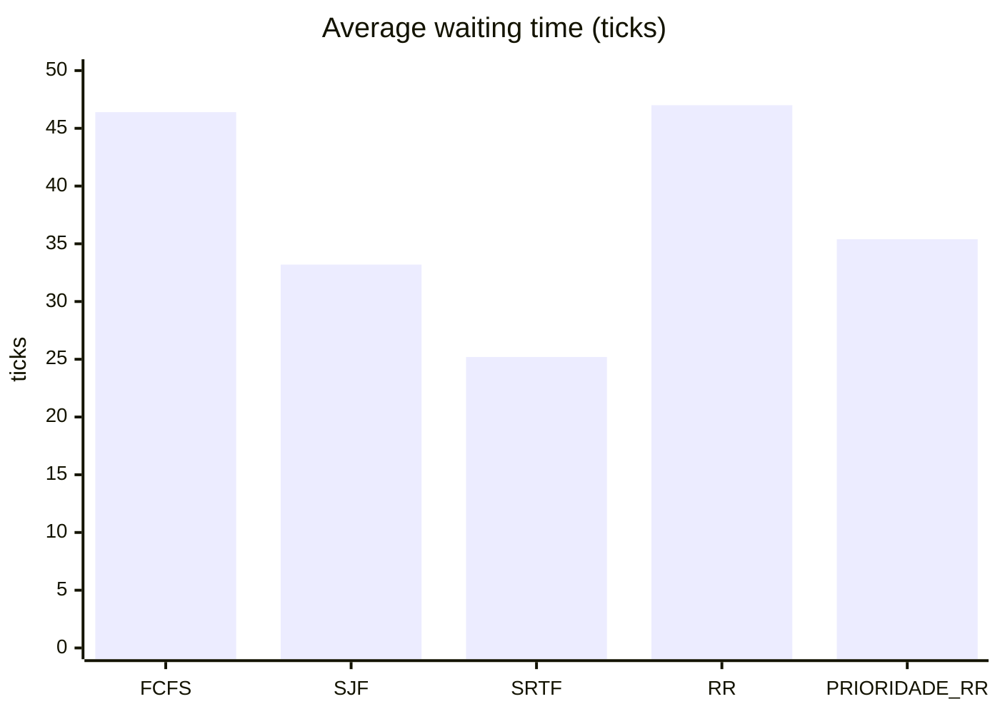
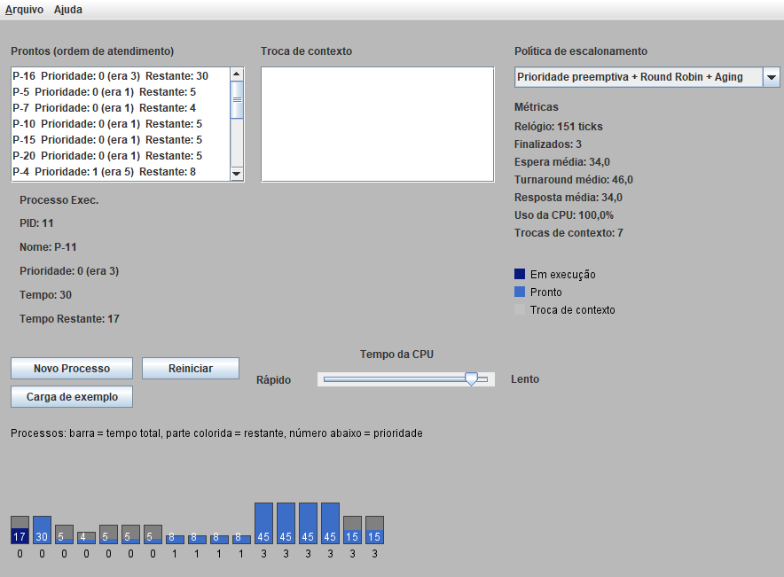
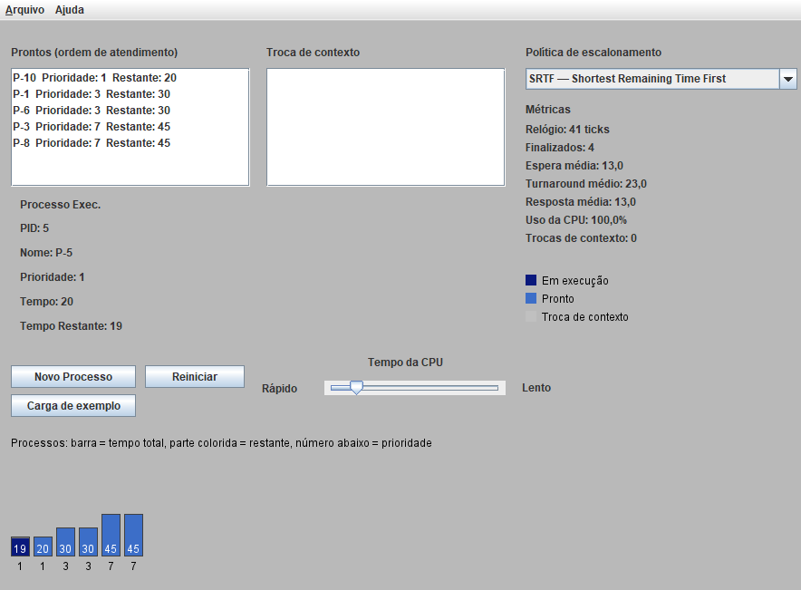

# process_scheduler

A CPU scheduling simulator with a Swing interface. Processes move between the ready queue, the CPU and a context-switch state while you watch, and the simulator measures waiting, turnaround and response times. Five scheduling policies can be switched at runtime.

**Course:** Operating Systems · **Year:** 2016 · **Language:** Java 8+ (standard library only)



## About

The original assignment was a single policy: Round Robin with priority preemption and a context-switch delay, animated in Swing. The 2026 revision rebuilt the core around a discrete clock, which made it possible to add more policies, aging, metrics and a deterministic test suite.

| Policy | Picks next | Preemptive | Time slice | Aging |
|---|---|:---:|:---:|:---:|
| **FCFS**: First Come, First Served | Arrival order | | | |
| **SJF**: Shortest Job First | Shortest total time | | | |
| **SRTF**: Shortest Remaining Time First | Shortest remaining time | ✓ | | |
| **RR**: Round Robin | Arrival order | | ✓ | |
| **PRIORIDADE_RR**: Priority + Round Robin | Lowest priority number | ✓ | ✓ | ✓ |

Ties are always broken in FIFO order (the order in which each process entered the ready queue).

## How it works

Each process goes through four states:



`Escalonador.tick()` advances the simulation by one time unit, always in the same order:



| Constant | Value | Meaning |
|---|---:|---|
| `FATIA_TEMPO` | 15 | Time slice (quantum), in ticks |
| `TEMPO_TROCA_CONTEXTO` | 2 | Ticks a preempted process spends switching out |
| `ENVELHECIMENTO` | 30 | Ticks in the ready queue for each priority boost |

Some details:

- **Context switches only happen when needed.** A process whose time slice runs out while it is alone gets a new slice instead of leaving the CPU idle.
- **Aging and the priority boost.** A boosted process keeps the boost while it is running and gets its original priority back when it leaves the CPU. Otherwise a process with a slightly better priority would preempt it on the very next tick.
- **One thread changes state.** Only the clock thread calls `tick()`, which is `synchronized`. The interface reads copies of the queues from a `javax.swing.Timer` running on the event dispatch thread.

### Metrics

Calculated over finished processes:

| Metric | Definition |
|---|---|
| Turnaround | finish − arrival |
| Waiting time | turnaround − CPU time |
| Response time | first dispatch − arrival |
| CPU usage | busy ticks ÷ ticks with any process in the system |

## Structure

```
src/
├── Main.java               entry point (opens the window)
├── TelaEscalonador.java    main frame and menus
├── PainelEscalonador.java  queues, metrics, bar chart, controls
├── NovoProcesso.java       "new process" form with validation
├── Escalonador.java        the scheduler: clock, queues, metrics
├── Politica.java           the five policies (ordering + preemption rules)
├── Processo.java           process data and per-process metrics
└── Comparador.java         CLI: runs one workload on every policy
test/
└── EscalonadorTest.java    tests, no external dependencies
```

## Running

```bash
javac -encoding UTF-8 -d out src/*.java
java -cp out Main          # graphical simulator
java -cp out Comparador    # policy comparison in the terminal
```

In the window, **Carga de exemplo** adds five sample processes, **Novo Processo** adds a custom one, and the slider sets the clock speed. You can change the policy while the simulation is running. The ready queue is reordered on the spot.

## Tests

```bash
javac -encoding UTF-8 -d out src/*.java test/*.java
java -cp out EscalonadorTest
```

```
  ok    FCFS: ordem de chegada, sem olhar prioridade
  ok    Métricas: espera 2.5, turnaround 6.5, resposta 2.5, CPU 100%
  ok    SJF: mais curto primeiro
  ok    SRTF: preempção pelo menor tempo restante
  ok    RR: cada um roda no máximo uma fatia por vez
  ok    Prioridade igual: atendimento FIFO
  ok    Prioridade: o mais prioritário preempta
  ok    Troca de contexto dura 2 ticks
  ok    Sozinho na CPU: sem troca de contexto inútil
  ok    Aging: prioridade 9 termina mesmo sob carga contínua de prioridade 2
  ok    Aging: o processo envelhecido não é preemptado logo ao entrar na CPU
  ok    Invariantes de estado em 200 simulações aleatórias (todas as políticas)

12 testes, 0 falhas
```

The clock is advanced manually with `tick()`, so every test is deterministic. Expected schedules are checked against a compact Gantt chart (`"1:3 2:2 1:7"` means P1 ran 3 ticks, then P2 ran 2, then P1 ran 7). The last test runs 200 random simulations and checks after every tick that each process is in the queue that matches its state.

## Example

`Comparador` runs the same workload on every policy. Processes arrive at different times:

```
Carga (chegada, tempo, prioridade):
  P1    0   30    3
  P2    2   12    1
  P3    4   45    7
  P4    6    8    5
  P5   10   20    1

Política         Espera  Turnaround  Resposta    CPU  Trocas
FCFS               46,4        69,4      46,4   100%       0
SJF                33,2        56,2      33,2   100%       0
SRTF               25,2        48,2      17,2   100%       1
RR                 47,0        70,0      22,4   100%       4
PRIORIDADE_RR      35,4        58,4      21,8   100%       6

Gantt (1 caractere = 2 ticks, '.' = CPU ociosa):
FCFS           1111111111111112222223333333333333333333333344445555555555
SJF            1111111111111114444222222555555555533333333333333333333333
SRTF           1222222444455555555551111111111111133333333333333333333333
RR             1111111122222233333334444555555511111111333333335533333333
PRIORIDADE_RR  1222222555555511551111111111111133333333443333333333333333
```

The results match the theory. SRTF, the optimal policy for average waiting time, wins on both waiting and response. Plain RR has almost the same waiting time as FCFS, but it halves the response time (46.4 → 22.4) because no process waits behind a long job for more than a time slice. That gain costs context switches.



### Screenshots

Aging under load: the ready queue shows boosted priorities as `0 (era 3)`, and the running process keeps its boost.



SRTF: the ready queue is ordered by remaining time.



## Notes

What changed in the 2026 revision:

- **Bug fix: "ghost" processes.** A process preempted on the same tick it finished stayed `FINALIZADO` in the context-switch queue forever. In stress runs this happened in 3 out of 4 executions. The rewrite has a single clock thread and a fixed order of steps per tick, and the invariant test covers this case.
- **No idle CPU on lone processes.** Before, a process alone in the system still went through a context switch at the end of every time slice.
- **Thread safety.** Swing components were updated from worker threads. The interface now refreshes from a Swing `Timer`, and the queues are read through copies.
- **New features:** the FCFS, SJF, SRTF and plain RR policies, aging, metrics, the sample workload, the policy comparison CLI and the tests.
- **Input validation.** New process time must be between 1 and 100 and priority between 0 and 9. Before, invalid input threw an exception.
