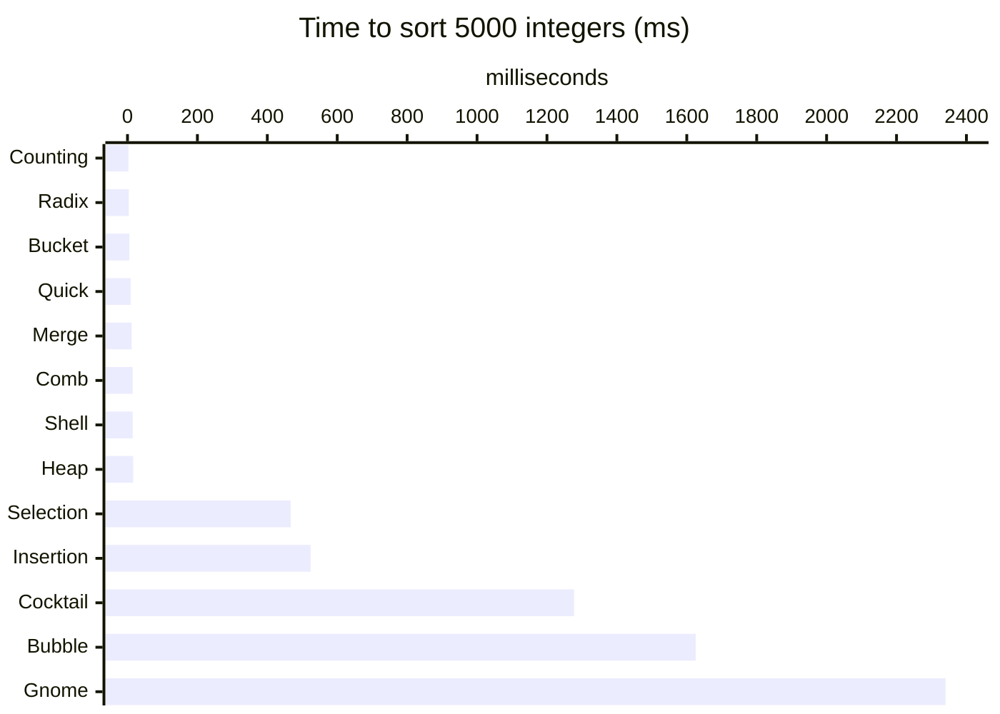

# sorting_algorithms_python

Thirteen sorting algorithms implemented from scratch in Python, with an interactive runner, a benchmark script and a test suite that checks every algorithm against Python's `sorted()`.

**Course:** Data Structures · Analysis and Complexity of Algorithms · **Year:** 2016–2018 · **Language:** Python 3 (standard library only)

## About

Implementations of the classic comparison sorts (Bubble, Insertion, Selection, Quick, Merge, Shell, Heap), the less common ones (Gnome, Comb, Cocktail) and the non-comparison sorts (Counting, Radix, Bucket). The goal is to connect the asymptotic analysis studied in class, Big-O for best, average and worst cases, with the running time measured in practice.

## How it works

Every function receives a list and returns a **new** sorted list; the input is never modified.

| Algorithm | Best | Average | Worst | Extra space | Stable | Idea |
|---|---|---|---|---|---|---|
| Bubble | O(n) | O(n²) | O(n²) | O(1) | yes | Swaps adjacent pairs; stops early when a pass makes no swaps |
| Cocktail | O(n) | O(n²) | O(n²) | O(1) | yes | Bubble sort alternating left→right and right→left passes |
| Gnome | O(n) | O(n²) | O(n²) | O(1) | yes | Steps back after each swap, like insertion done with swaps |
| Insertion | O(n) | O(n²) | O(n²) | O(1) | yes | Inserts each element into the sorted prefix |
| Selection | O(n²) | O(n²) | O(n²) | O(1) | no | Selects the minimum of the unsorted part and swaps it into place |
| Shell | O(n log n) | ~O(n^1.5) | O(n²) | O(1) | no | Insertion sort over shrinking gaps (n/2, n/4, …, 1) |
| Comb | O(n log n) | O(n²/2ᵖ) | O(n²) | O(1) | no | Bubble sort over a gap that shrinks by 1.25 each pass |
| Quick | O(n log n) | O(n log n) | O(n²) | O(n) | yes | Middle pivot, three-way partition (`<`, `=`, `>`) into new lists |
| Merge | O(n log n) | O(n log n) | O(n log n) | O(n) | yes | Splits in half, sorts each half, merges by index |
| Heap | O(n log n) | O(n log n) | O(n log n) | O(1) | no | Builds a max-heap in place, then moves the root to the end |
| Counting | O(n + k) | O(n + k) | O(n + k) | O(k) | — | Counts occurrences of each value in the range k = max − min |
| Radix | O(d·(n + b)) | O(d·(n + b)) | O(d·(n + b)) | O(n + b) | — | LSD, base b = 10, one bucket pass per digit (d digits); negatives sorted by magnitude |
| Bucket | O(n + k) | O(n + k) | O(n²) | O(n + k) | — | Spreads values over buckets of width 5, insertion-sorts each bucket |

*p* in Comb is the number of gap reductions. **Stable** means equal keys keep their original order; it is tested for the comparison sorts. Counting, Radix and Bucket work on integers, where stability makes no visible difference.

## Benchmark

Best of 3 runs on random integers, same arrays for every algorithm (`python benchmark.py`):

| Algorithm | n = 100 | n = 1000 | n = 5000 |
|---|---:|---:|---:|
| Counting | 0.05 ms | 0.52 ms | 2.59 ms |
| Radix | 0.06 ms | 0.63 ms | 3.81 ms |
| Bucket | 0.11 ms | 1.07 ms | 5.42 ms |
| Quick | 0.11 ms | 1.52 ms | 9.31 ms |
| Merge | 0.17 ms | 2.02 ms | 11.99 ms |
| Comb | 0.13 ms | 1.91 ms | 14.65 ms |
| Shell | 0.09 ms | 1.92 ms | 14.95 ms |
| Heap | 0.16 ms | 2.49 ms | 16.11 ms |
| Selection | 0.18 ms | 18.08 ms | 466.81 ms |
| Insertion | 0.19 ms | 21.81 ms | 523.75 ms |
| Cocktail | 0.44 ms | 48.38 ms | 1277.44 ms |
| Bubble | 0.43 ms | 50.64 ms | 1625.58 ms |
| Gnome | 0.64 ms | 84.87 ms | 2340.06 ms |



With 100 elements every algorithm finishes in under a millisecond. Going from 1000 to 5000 elements (5×), the O(n²) algorithms get about 25–30× slower, while the O(n log n) ones get 6–8× slower, as the analysis predicts. Counting and Radix are fastest here because the range of values is small (k = 10n).

## Structure

```
src/
├── sort/sort.py     ← the 13 algorithms
├── main.py          ← interactive runner: random array, pick one algorithm or all, prints time
└── benchmark.py     ← timing table for several sizes, in Markdown
tests/
└── test_sort.py     ← edge cases, 200 random arrays, stability and regression tests
```

## Running

**Requirements:** Python 3.6+

```bash
cd src
python main.py            # interactive
python benchmark.py       # default sizes: 100 1000 5000
python benchmark.py 20000 # custom sizes
```

## Tests

From the project root:

```bash
python -m unittest discover -s tests -t .
```

Every algorithm is checked against `sorted()` on 10 edge cases (empty, single element, reversed, duplicates, negatives…) and 200 random arrays, about 2,750 assertions in total.

## Example

```
Size of the array to be sorted: 8
Smallest possible number: -20
Largest possible number: 20

Original array:
[17, -17, 12, -20, 17, 10, -1, 16]

Choose a Sort Algorithm:
0  -  Bubble
...
13  -  All
x
Please type an integer.
5

Sorting by Shell method...

Ordered array:
[-20, -17, -1, 10, 12, 16, 17, 17]

Time spent sorting: 0.000010 s
```

`Ctrl+C` exits.

## Notes

- Counting and Bucket allocate memory proportional to the value range (max − min): fine for the runner's ranges, impractical for values spread across something like 10¹⁷.
- Quick and Merge build new lists at each level instead of sorting in place; this keeps them short and readable at the cost of O(n) extra memory.
- Revised in 2026: test suite and benchmark added. Fixes found by the tests: Bubble left 2-element lists unsorted, Cocktail sometimes returned `None`, Radix failed on negative and very large integers, Quick hit the recursion limit on sorted input (first-element pivot), and Merge was quadratic because of `list.pop(0)`. The unused `numpy`/`PyQt5`/`pyqtgraph` requirements were removed.
