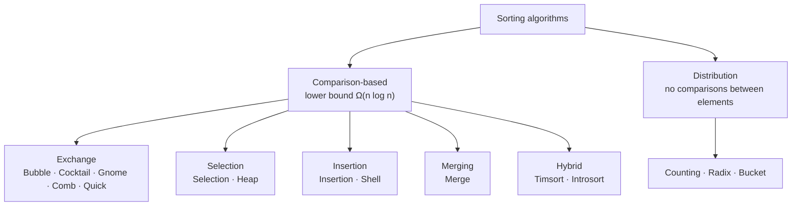
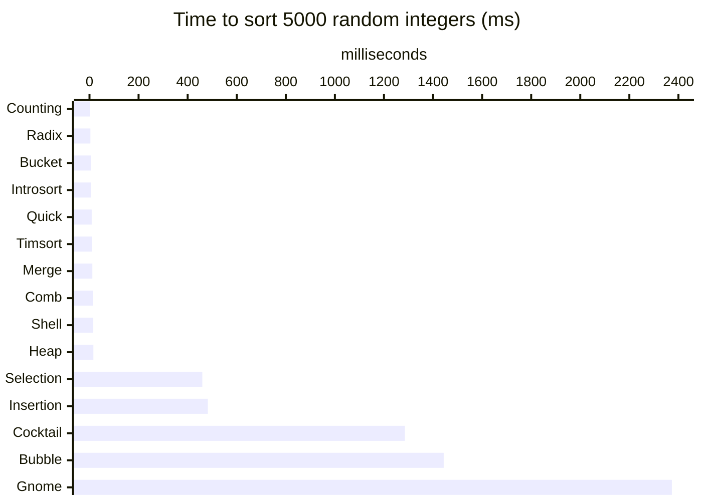

# sorting_algorithms_python

Fifteen sorting algorithms implemented from scratch in Python and organized by category, with an interactive runner, a benchmark script and a test suite that checks every algorithm against Python's `sorted()`.

**Course:** Data Structures · Analysis and Complexity of Algorithms · **Year:** 2016–2018 · **Language:** Python 3 (standard library only)

## About

Implementations of the classic comparison sorts, the less common ones (Gnome, Comb, Cocktail), the non-comparison sorts (Counting, Radix, Bucket) and the two hybrids used in real standard libraries: **Timsort** (Python) and **Introsort** (C++). The goal is to connect the asymptotic analysis studied in class, Big-O for best, average and worst cases, with the running time measured in practice.

## Categories

Sorting algorithms are classified by the mechanism they use to put elements in order (Knuth, *The Art of Computer Programming*, vol. 3). The package follows that classification: one module per category.



| Category | Mechanism |
|---|---|
| Exchange | Compares pairs of elements and swaps the ones out of order |
| Selection | Repeatedly selects the smallest (or largest) remaining element and moves it into place |
| Insertion | Inserts each element into an already sorted part of the list |
| Merging | Combines already sorted sequences into a larger one |
| Distribution | Places elements by value or digit; never compares two elements |
| Hybrid | Combines categories, using each where it performs best |

**Why distribution sorts can beat O(n log n):** any algorithm that only compares elements needs at least log₂(n!) ≈ n log₂ n comparisons in the worst case, because each comparison has two outcomes and there are n! possible orders to tell apart. Counting and Radix never compare elements, so that bound doesn't apply; their cost depends on the range of values (k) or the number of digits (d) instead.

Besides the category, each algorithm has **properties**: *stable* (equal keys keep their original order), *in-place* (O(1) extra memory) and *adaptive* (faster on partially sorted input).

## How it works

Every function receives a list and returns a **new** sorted list; the input is never modified.

| Category | Algorithm | Best | Average | Worst | Extra space | Stable | Adaptive | Idea |
|---|---|---|---|---|---|---|---|---|
| Exchange | Bubble | O(n) | O(n²) | O(n²) | O(1) | yes | yes | Swaps adjacent pairs; stops early when a pass makes no swaps |
| Exchange | Cocktail | O(n) | O(n²) | O(n²) | O(1) | yes | yes | Bubble sort alternating left→right and right→left passes |
| Exchange | Gnome | O(n) | O(n²) | O(n²) | O(1) | yes | yes | Steps back after each swap, like insertion done with swaps |
| Exchange | Comb | O(n log n) | O(n²/2ᵖ) | O(n²) | O(1) | no | no | Bubble sort over a gap that shrinks by 1.25 each pass |
| Exchange | Quick | O(n log n) | O(n log n) | O(n²) | O(n) | yes | no | Middle pivot, three-way partition (`<`, `=`, `>`) into new lists |
| Selection | Selection | O(n²) | O(n²) | O(n²) | O(1) | no | no | Selects the minimum of the unsorted part and swaps it into place |
| Selection | Heap | O(n log n) | O(n log n) | O(n log n) | O(1) | no | no | Builds a max-heap in place, then moves the root to the end |
| Insertion | Insertion | O(n) | O(n²) | O(n²) | O(1) | yes | yes | Inserts each element into the sorted prefix |
| Insertion | Shell | O(n log n) | ~O(n^1.5) | O(n²) | O(1) | no | partly | Insertion sort over shrinking gaps (n/2, n/4, …, 1) |
| Merging | Merge | O(n log n) | O(n log n) | O(n log n) | O(n) | yes | no | Splits in half, sorts each half, merges by index |
| Distribution | Counting | O(n + k) | O(n + k) | O(n + k) | O(k) | — | — | Counts occurrences of each value in the range k = max − min |
| Distribution | Radix | O(d·(n + b)) | O(d·(n + b)) | O(d·(n + b)) | O(n + b) | — | — | LSD, base b = 10, one bucket pass per digit (d digits); negatives sorted by magnitude |
| Distribution | Bucket | O(n + k) | O(n + k) | O(n²) | O(n + k) | — | — | Spreads values over buckets of width 5, insertion-sorts each bucket |
| Hybrid | Timsort | O(n) | O(n log n) | O(n log n) | O(n) | yes | yes | Natural runs + binary insertion + balanced merges |
| Hybrid | Introsort | O(n log n) | O(n log n) | O(n log n) | O(log n) | no | no | Quicksort, heapsort when recursion gets too deep, insertion on small partitions |

*p* in Comb is the number of gap reductions. Stability is tested for the comparison sorts; Counting, Radix and Bucket work on integers, where stability makes no visible difference.

**Timsort** splits the list into *runs* (stretches already in order, ascending or strictly descending), extends short runs to `min_run` elements with binary insertion sort and merges them from a stack whose size invariants keep the merges balanced. On already sorted input there is a single run: O(n).

**Introsort** runs an in-place quicksort with a median-of-three pivot. If the recursion gets deeper than 2·log₂ n, a sign of bad pivots, it switches to heapsort, which caps the worst case at O(n log n). Partitions with 16 or fewer elements are finished with insertion sort.

## Benchmark

Best of 3 runs on the same random integers for every algorithm, plus an already sorted array (`python benchmark.py`):

| Algorithm | Category | n = 100 | n = 1000 | n = 5000 | n = 5000, sorted |
|---|---|---:|---:|---:|---:|
| Bubble | Exchange | 0.45 ms | 56.97 ms | 1443.43 ms | 0.25 ms |
| Cocktail | Exchange | 0.43 ms | 46.05 ms | 1285.29 ms | 0.50 ms |
| Gnome | Exchange | 0.64 ms | 85.63 ms | 2373.17 ms | 0.52 ms |
| Comb | Exchange | 0.08 ms | 1.84 ms | 13.78 ms | 11.01 ms |
| Quick | Exchange | 0.11 ms | 1.52 ms | 8.93 ms | 6.47 ms |
| Selection | Selection | 0.19 ms | 18.24 ms | 459.78 ms | 476.84 ms |
| Heap | Selection | 0.15 ms | 2.49 ms | 15.89 ms | 16.04 ms |
| Insertion | Insertion | 0.18 ms | 18.56 ms | 482.11 ms | 0.59 ms |
| Shell | Insertion | 0.09 ms | 1.90 ms | 14.97 ms | 5.33 ms |
| Merge | Merging | 0.16 ms | 2.03 ms | 11.75 ms | 8.14 ms |
| Counting | Distribution | 0.05 ms | 0.51 ms | 2.66 ms | 1.13 ms |
| Radix | Distribution | 0.06 ms | 0.63 ms | 3.74 ms | 3.01 ms |
| Bucket | Distribution | 0.11 ms | 1.09 ms | 5.53 ms | 1.94 ms |
| Timsort | Hybrid | 0.10 ms | 1.61 ms | 10.34 ms | 0.36 ms |
| Introsort | Hybrid | 0.07 ms | 0.99 ms | 6.52 ms | 4.92 ms |



**Growth matches the analysis.** From 1000 to 5000 elements (5×), the O(n²) algorithms get about 25× slower (5²), while the O(n log n) ones get 6–7× slower (5 · log 5000 / log 1000 ≈ 6.2). Counting and Radix are fastest because the range of values is small (k = 10n).

**Adaptivity.** On already sorted input, Bubble, Insertion and Timsort finish in under 1 ms, while Selection takes the same ~470 ms as always, because it scans the whole unsorted part regardless of order. Timsort goes from 10.3 ms to 0.36 ms, which is why Python chose it: real data is often partially sorted.

## Structure

```
src/
├── sort/
│   ├── __init__.py       ← exports every algorithm and CATEGORIES
│   ├── exchange.py       ← Bubble, Cocktail, Gnome, Comb, Quick
│   ├── selection.py      ← Selection, Heap
│   ├── insertion.py      ← Insertion, Shell
│   ├── merging.py        ← Merge
│   ├── distribution.py   ← Counting, Radix, Bucket
│   └── hybrid.py         ← Timsort, Introsort
├── main.py               ← interactive runner, menu grouped by category
└── benchmark.py          ← Markdown timing table (random and sorted input)
tests/
└── test_sort.py          ← edge cases, random arrays, stability, hybrids and regressions
```

## Running

**Requirements:** Python 3.6+

```bash
cd src
python main.py            # interactive
python benchmark.py       # default sizes: 100 1000 5000
python benchmark.py 20000 # custom sizes
```

## Tests

From the project root:

```bash
python -m unittest discover -s tests -t .
```

Every algorithm is checked against `sorted()` on 10 edge cases (empty, single element, reversed, duplicates, negatives…) and 200 random arrays; the hybrids are also tested on large inputs that exercise Timsort's run merging and Introsort's heapsort fallback. Over 3,000 assertions in total.

## Example

```
Original array:
[-6, -12, 17, -5, 12, -6, 0, -4]

Choose a Sort Algorithm:
  Exchange:
   0 - Bubble
   1 - Cocktail
   2 - Gnome
   3 - Comb
   4 - Quick
  Selection:
   5 - Selection
   6 - Heap
  Insertion:
   7 - Insertion
   8 - Shell
  Merging:
   9 - Merge
  Distribution:
  10 - Counting
  11 - Radix
  12 - Bucket
  Hybrid:
  13 - Timsort
  14 - Introsort
  15 - All
13

Sorting by Timsort method (Hybrid)...

Ordered array:
[-12, -6, -6, -5, -4, 0, 12, 17]

Time spent sorting: 0.000013 s
```

Non-numeric input is rejected with a message; `Ctrl+C` exits.

## Notes

- Timsort is simplified: it leaves out CPython's "galloping" mode, which speeds up merges when one run keeps winning.
- Introsort reuses the package's own `heap()` and `insertion()` on list slices for its fallback and final steps, which costs O(n) temporary memory in those steps.
- Counting and Bucket allocate memory proportional to the value range (max − min): fine for the runner's ranges, impractical for values spread across something like 10¹⁷.
- Quick and Merge build new lists at each level instead of sorting in place; this keeps them short and readable at the cost of O(n) extra memory.
- Revised in 2026: test suite and benchmark added, algorithms split by category, Timsort and Introsort added. Fixes found by the tests: Bubble left 2-element lists unsorted, Cocktail sometimes returned `None`, Radix failed on negative and very large integers, Quick hit the recursion limit on sorted input (first-element pivot), and Merge was quadratic because of `list.pop(0)`. The unused `numpy`/`PyQt5`/`pyqtgraph` requirements were removed.
