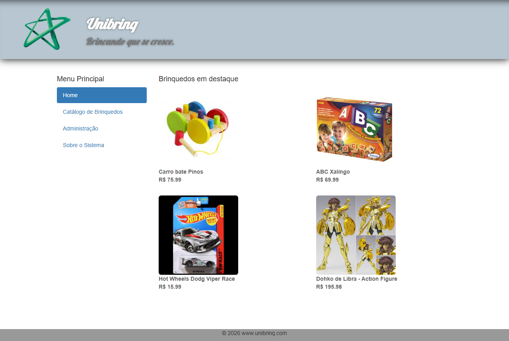
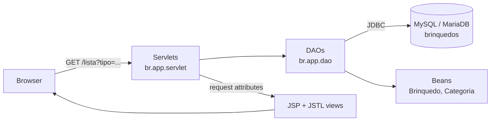
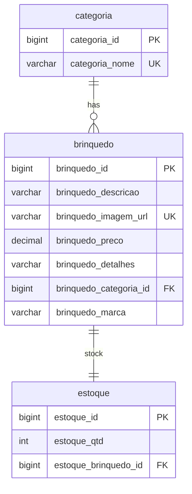
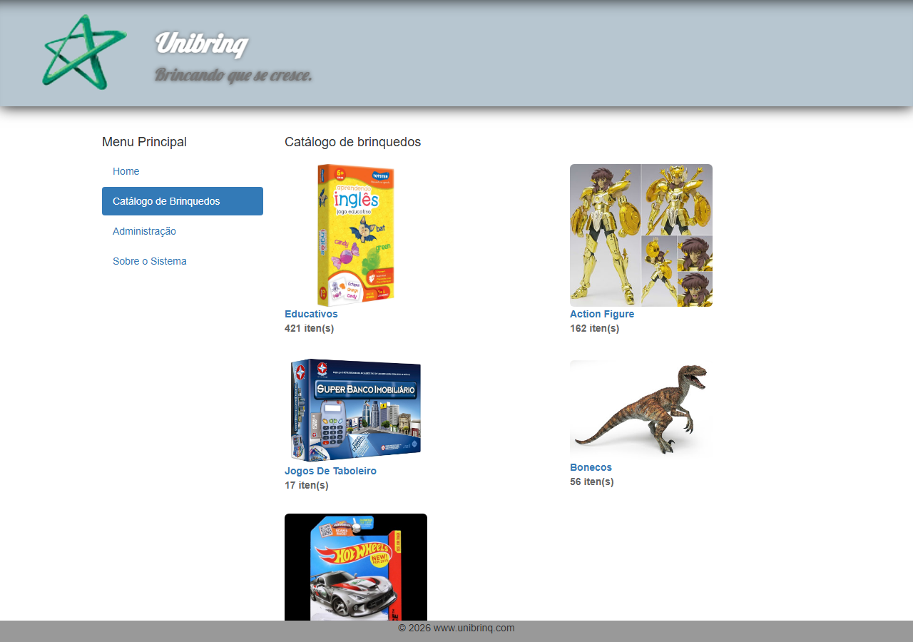
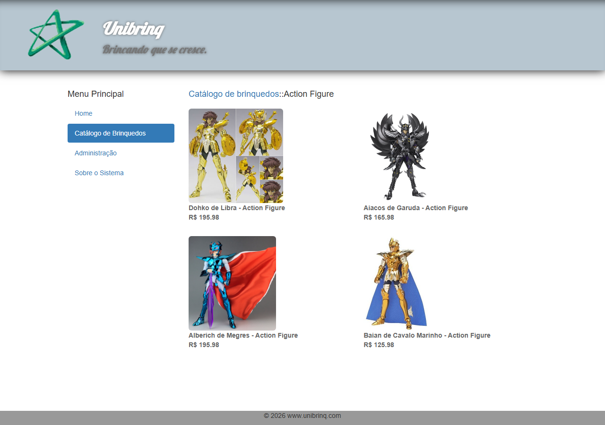
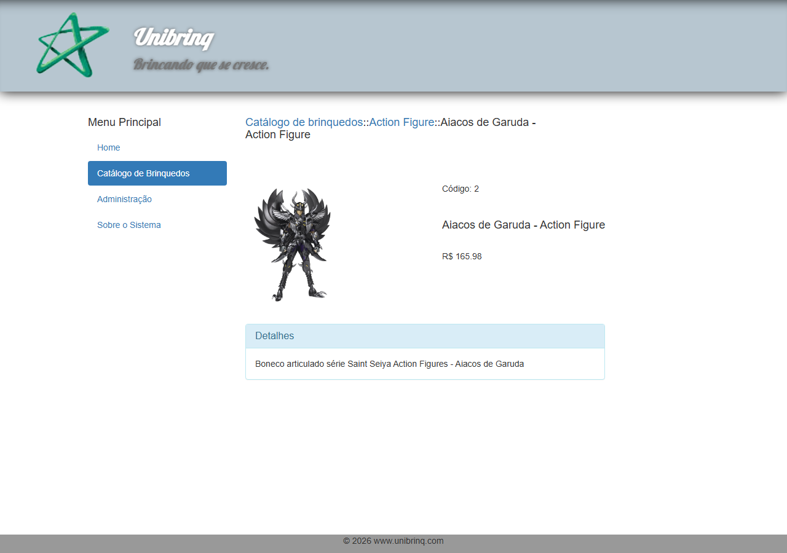
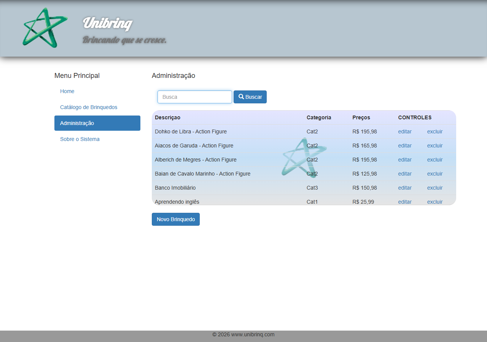
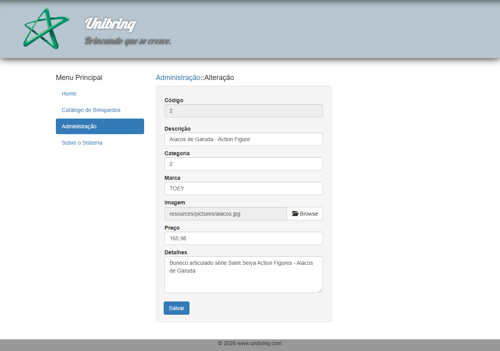
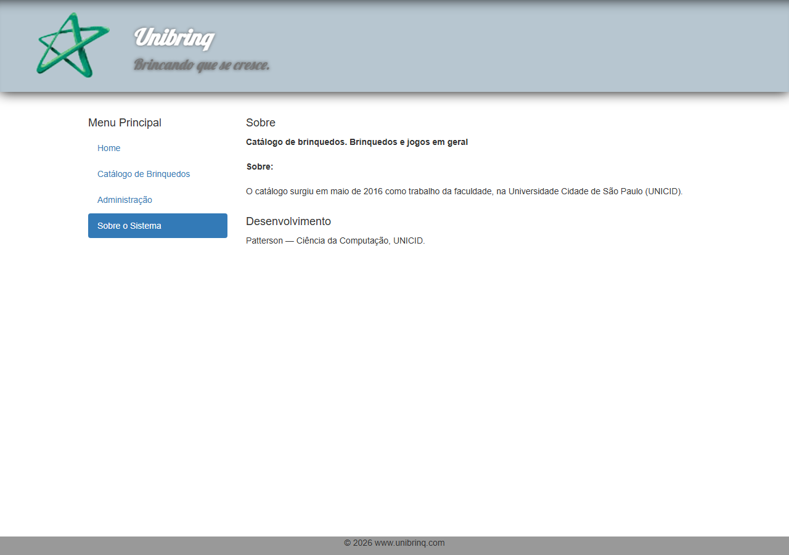

# toys_catalog

**Unibrinq** is a toy store catalog web app: a storefront with featured products and a browsable catalog by category, plus an administration area to create, edit, search and delete toys. It is written in Java with Servlets, JSP and JDBC on top of a MySQL/MariaDB database that uses stored procedures, a function and a trigger.

**Course:** Web Applications · **Year:** 2016–2017 · **Stack:** Java 8, Servlet 3.1, JSP + JSTL, JDBC, MySQL/MariaDB, Bootstrap 3, jQuery · **Server:** Apache Tomcat 9



## About

The home page shows **featured toys**: the four with the most units in stock, on the reasoning that those are the ones the store most needs to sell. The **catalog** groups toys by category, showing each category's total stock. The **administration** area lists every toy with a search box and links to edit, delete and add.

Navigation runs inside a single page. The menu loads each section into an `iframe`, and `main.js` reads the title of the loaded page to update the breadcrumb above it (`Catálogo de brinquedos::Action Figure::...`).

## How it works

The code follows MVC: servlets are the controllers, DAOs talk to the database through JDBC, and JSP pages render the views with JSTL.



| URL | Servlet | What it does | View |
|---|---|---|---|
| `/index` | `Main` | Main page with the current year in the footer | `index.jsp` |
| `/lista?tipo=destaque` | `ListaBrinquedo` | Top 4 toys by stock (Java 8 streams: `filter`, `sorted`, `limit`) | `tabela_brinquedo.jsp` |
| `/lista?tipo=catalogo` | `ListaBrinquedo` | Categories with total stock (stored procedure) | `tabela_brinquedo.jsp` |
| `/lista?tipo=categoria&idCategoria=N` | `ListaBrinquedo` | Toys in stock in one category | `tabela_brinquedo.jsp` |
| `/lista?filtro=...` | `ListaBrinquedo` | Administration list and search | `lista_brinquedos.jsp` |
| `/detalhe?cod=N` | `DetalheBrinquedo` | Product page | `detalhe_brinquedo.jsp` |
| `/novo`, `/editar?cod=N` | `CadastroBrinquedo`, `AlteracaoBrinquedo` | Form (GET) and save (POST) | `form_brinquedo.jsp` |
| `/excluir?cod=N` | `ExclusaoBrinquedo` | Delete and return to the list | |

### Database



Part of the logic lives in the database:

| Object | Type | Purpose |
|---|---|---|
| `categoriaBrinquedoQtd()` | Procedure | Categories with their total stock and a sample image, used by the catalog page (called through `CallableStatement`) |
| `brinquedoCategoria(id)` | Procedure | Toys of a category with price formatted in `pt_BR` |
| `af_brinquedoInsert` | Trigger | Creates the stock row (quantity 0) whenever a toy is inserted |
| `CAP_FIRST(text)` | Function | Capitalizes each word (`jogos de taboleiro` → `Jogos De Taboleiro`) |

Foreign keys cascade on delete, so deleting a toy also deletes its stock row.

## Structure

```
src/br/app/
├── bean/        Brinquedo, Categoria
├── dao/         BrinquedoDAO, CategoriaDAO (JDBC)
├── servlet/     controllers, mapped with @WebServlet
└── util/        ConnectionFactory
WebContent/
├── *.jsp        views
├── resources/   CSS, JavaScript, Bootstrap, jQuery, product pictures
└── WEB-INF/     web.xml and libraries (JSTL, MySQL Connector/J 5.1.15)
mysql_brinquedos.sql     schema, sample data, procedures, trigger and function (MySQL)
mariadb_brinquedos.sql   same script adapted for MariaDB
```

## Running

Requires a JDK (8 or newer), Apache Tomcat 9 (the code uses `javax.servlet`, so Tomcat 10+ will not work) and MySQL or MariaDB.

1. Create the database and the user that `ConnectionFactory` expects (`patterson` / `1234` on `localhost:3306`):

   ```bash
   mariadb -uroot --default-character-set=latin1 < mariadb_brinquedos.sql
   mariadb -uroot -e "CREATE USER 'patterson'@'localhost' IDENTIFIED BY '1234';
                      GRANT ALL ON brinquedos.* TO 'patterson'@'localhost';"
   ```

   The SQL script is encoded in ISO-8859-1, hence `latin1`.

2. Copy the web content to Tomcat and compile the servlets into `WEB-INF/classes`:

   ```bash
   APP=$CATALINA_HOME/webapps/toys_catalog
   cp -r WebContent/. $APP/
   javac -encoding ISO-8859-1 -cp $CATALINA_HOME/lib/servlet-api.jar \
         -d $APP/WEB-INF/classes $(find src -name '*.java')
   ```

3. Start Tomcat (`catalina.sh run`) and open <http://localhost:8080/toys_catalog/index>.

Originally the project was an Eclipse Dynamic Web Project (`.project`, `.settings`), which can still be imported and run on a Tomcat server configured in the IDE.

## Screenshots

| | |
|---|---|
|  |  |
| Catalog by category, with total stock | One category |
|  |  |
| Product page, with the breadcrumb | Administration: list and search |
|  |  |
| Edit form | About page |

## Notes

Checked in 2026 without changing the code: Tomcat 9.0.123, MariaDB 11.4 and JDK 25, still using the original MySQL Connector/J 5.1.15 from 2011. The screenshots above come from that run.
